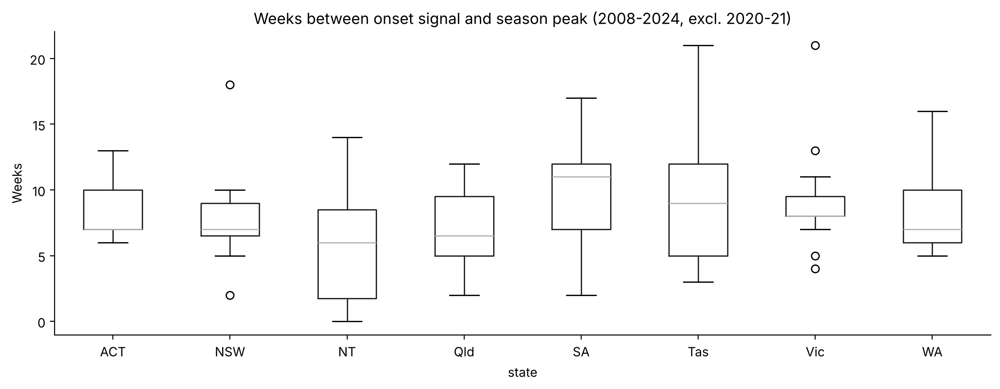

# When does flu season actually start in Australia?

I wanted to know three things:

- When does flu season start and peak in each state?
- Has that timing changed since COVID?
- Could you spot the start early enough to warn people before it gets bad?

To answer them I used every lab-confirmed flu case reported in Australia from 2008 to 2024. That's just under 2 million rows from the national notifiable diseases dataset (NNDSS).


## What I found

**Flu season now arrives earlier.** Before COVID, cases usually peaked in mid to late August. Since 2022 the peak has come anywhere from late May to early August. You can see it in the chart above: 2022 (green) and 2024 (purple) both peak well before 2017 (blue).

The chart below breaks it down by state. Each dot is the week that state's season peaked, and lower means earlier. From 2008 to 2018 most seasons peaked around weeks 33 to 37, apart from early years like 2009 and 2012. In 2019, 2022 and 2023 most states dropped to weeks 21 to 27. 2024 crept back up to weeks 27 to 32, still earlier than the old pattern. So the shift may have started in 2019, just before COVID. (2020 and 2021 are missing because there was barely any flu.)


**You get a decent warning.** I tested a simple rule. If weekly cases stay at three times the usual summer level for two weeks in a row, call it the start of the season. That signal shows up about 6 to 11 weeks before the peak in most states. That's plenty of time to tell people to get vaccinated.

The box chart below shows how much warning each state got across 12 to 15 seasons. The grey line in each box is the typical (median) year. The box holds the middle half of years, and the whiskers and circles show the extremes.



| State | Typical warning | Shortest | Longest |
| --- | --- | --- | --- |
| SA | 11 weeks | 2 | 17 |
| Tas | 9 weeks | 3 | 21 |
| Vic | 8 weeks | 4 | 21 |
| NSW, ACT, WA | 7 weeks | 2 to 6 | 13 to 18 |
| Qld | 6.5 weeks | 2 | 12 |
| NT | 6 weeks | 0 | 14 |

Victoria is the most predictable: most years land between 8 and 9.5 weeks. NT is the least reliable. In some years the signal fired the same week as the peak, which is no warning at all. That fits NT's tropical climate, where flu doesn't follow a clear winter season.

**Bigger numbers don't always mean a worse year.** 2024 had the most cases on record (364k). But far more people got tested after COVID, so some of that jump is just more testing.

**COVID almost wiped flu out.** 2020 had 21k cases. 2021 had fewer than 1,000.

**Young people make up a big share of cases.** People aged 5 to 19 were about a third of cases from 2022 to 2024. Kids under 5 were another 13%. These are raw counts though, not rates, so I can't say who's most at risk yet.

**It's mostly influenza A.** B had its big years in 2008 and 2015. In 2024, 96% of cases were A.


## Where it falls short

- **This counts people who got tested, not everyone who got sick.** Testing went up a lot after 2020.
- **No population rates yet.** I'd need ABS population data to compare states or age groups fairly.
- **Some fields are mostly empty.** Indigenous status is unknown for 55% of cases. About 70% have no flu subtype, so I only compared A against B.
- **My early-warning rule broke in 2022.** After two years of almost no flu, the summer baseline was close to zero, so the rule fired straight away in every state. It needs a minimum baseline to be reliable.
- **The data only updates once a year.** Good for spotting patterns, not for live alerts.

## How I did it

All the work is in [`flu_analysis.ipynb`](flu_analysis.ipynb):

1. Loaded the four Excel sheets and stacked them into one table.
2. Cleaned it up: fixed dates, tidied messy values like blank or "NOT STATED" sex, grouped ages into bands, and added season and week columns.
3. Checked quality: missing values, duplicates, and weeks where a state reported zero cases.
4. Answered five questions: how big each season was, when it started and peaked, how much warning you get, who was affected, and which flu type led.
5. Exported three tidy files for a Power BI dashboard.

## Files

| File | What's in it |
| --- | --- |
| `data/clean/flu_cases_agg.csv` | Case counts by week, state, age, sex and flu type |
| `data/clean/flu_weekly_state.csv` | Weekly cases per state, including weeks with zero cases |
| `data/clean/flu_season_summary.csv` | One row per state per year: start week, peak week, peak cases and weeks of warning |

## Data source

[NNDSS public dataset: influenza (laboratory confirmed)](https://www.cdc.gov.au/resources/publications/nndss-dataset-influenza), Australian Centre for Disease Control. It covers 2008 to 2024, extracted 28 May 2025. Worth reading the [data caveats](https://www.cdc.gov.au/system/files/2025-10/influenza_laboratory_confirmed_public_dataset_2008_to_2024_data_caveats_0.pdf) before using the numbers.

The raw Excel file is 47 MB, so it isn't in this repo. To rerun the notebook, download it and drop it into `data/raw/`, then:

```bash
pip install -r requirements.txt
jupyter notebook flu_analysis.ipynb
```

**Tools:** Python (pandas, NumPy, Matplotlib), Jupyter, Power BI
