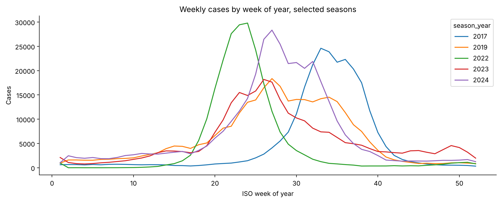
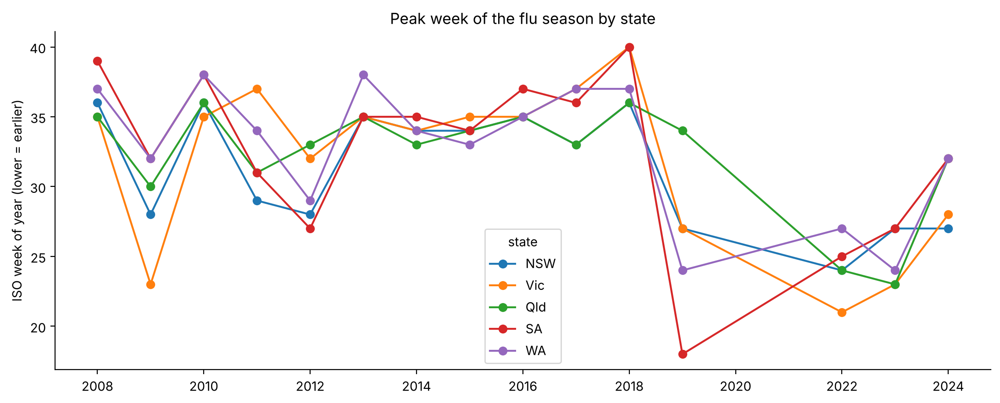
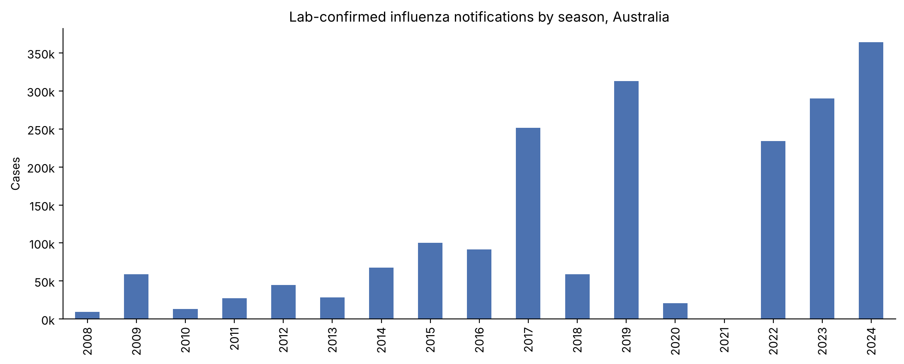

# When does flu season actually start in Australia?

I wanted to know three things:

- When does flu season start and peak in each state?
- Has that timing changed since COVID?
- Could you spot the start early enough to warn people before it gets bad?

To answer them I used every lab-confirmed flu case reported in Australia from 2008 to 2024. That's just under 2 million rows from the national notifiable diseases dataset (NNDSS).



## What I found

**Flu season now arrives earlier.** Before COVID, cases usually peaked in mid to late August. Since 2022 the peak has come anywhere from late May to early August. You can see it in the chart above: 2022 (green) and 2024 (purple) both peak well before 2017 (blue).

The chart below breaks it down by state. Each dot is the week that state's season peaked, and lower means earlier. From 2008 to 2018 most seasons peaked around weeks 33 to 37, apart from early years like 2009 and 2012. In 2019, 2022 and 2023 most states dropped to weeks 21 to 27. 2024 crept back up to weeks 27 to 32, still earlier than the old pattern. So the shift may have started in 2019, just before COVID. (2020 and 2021 are missing because there was barely any flu.)



**You get a decent warning.** I tested a simple rule. If weekly cases stay at three times the usual summer level for two weeks in a row, call it the start of the season. That signal shows up about 6 to 11 weeks before the peak in most states. That's plenty of time to tell people to get vaccinated.

The box chart below shows how much warning each state got across 12 to 15 seasons. The grey line in each box is the typical (median) year. The box holds the middle half of years, and the whiskers and circles show the extremes.


| State | Typical warning | Shortest | Longest |
| --- | --- | --- | --- |
| SA | 11 weeks | 2 | 17 |
| Tas | 9 weeks | 3 | 21 |
| Vic | 8 weeks | 4 | 21 |
| NSW, ACT, WA | 7 weeks | 2 to 6 | 13 to 18 |
| Qld | 6.5 weeks | 2 | 12 |
| NT | 6 weeks | 0 | 14 |

Victoria is the most predictable: most years land between 8 and 9.5 weeks. NT is the least reliable. In some years the signal fired the same week as the peak, which is no warning at all. That fits NT's tropical climate, where flu doesn't follow a clear winter season.

**Bigger numbers don't always mean a worse year.** 2024 had the most cases on record (364k). But far more people got tested after COVID, so some of that jump is just more testing.

**COVID almost wiped flu out.** 2020 had 21k cases. 2021 had fewer than 1,000.

**Young people make up a big share of cases.** People aged 5 to 19 were about a third of cases from 2022 to 2024. Kids under 5 were another 13%. These are raw counts though, not rates, so I can't say who's most at risk yet.

**It's mostly influenza A.** B had its big years in 2008 and 2015. In 2024, 96% of cases were A.



### The odd years (the circles)

Six seasons sit outside the normal range on the box chart. I went back to check each one.

| State | Year | Warning | What happened |
| --- | --- | --- | --- |
| Vic | 2008 | 21 weeks | Summer level was tiny (1.5 cases a week) |
| NSW | 2008 | 18 weeks | Summer level was tiny (5.5 cases a week) |
| Vic | 2017 | 13 weeks | Huge season that built up slowly |
| Vic | 2009 | 5 weeks | Swine flu pandemic, fast and early |
| Vic | 2018 | 4 weeks | Mild year straight after the huge 2017 season |
| NSW | 2018 | 2 weeks | Mild year straight after the huge 2017 season |

They fall into three groups:

- **Summer was too quiet (2008).** Not many people got tested back then. Three times almost nothing is still almost nothing, so the alarm went off far too early. 2022 has the same problem after two years of almost no flu.
- **Summer was too busy (2018).** After 2017, a lot more people were getting tested even in summer. Three times that level took ages to reach, so the alarm went off late.
- **Unusual seasons (2009 and 2017).** A pandemic that hit fast and a big season that built slowly. No simple rule handles these perfectly.

So the weak spot is that the rule leans too hard on how busy January to March was that one year.

### How I'd make the rule better

- **Set a minimum summer level.** Never let the baseline drop below a floor, for example 20 cases a week. That would fix 2008 and 2022.
- **Use more than one summer.** Base it on the average of the last three years instead of just the current one, so one unusual summer can't throw it off.
- **Use rates instead of counts.** Cases per 100,000 people, using ABS population data, would also soften the jump in testing after COVID.
- **Then re-run the box chart.** If the circles shrink, the rule got better.

## Limitations

**This is confirmed cases, not everyone who had flu.**
Each row is a person who got a lab test that came back positive. People who were sick but didn't see a doctor, or saw one and weren't tested, aren't in it. Negative tests aren't in it either, so there's no way to tell how many tests were done.

**More cases doesn't always mean more flu.**
How many sick people get tested changes over time. Among Australians with fever and cough, the share who got a flu test went from 2.9% in 2016 to 5.0% in 2017 ([Flutracking](https://ojs.cdi.cdc.gov.au/index.php/cdi/article/view/633/2565)). NSW Health put most of its 2017 rise down to GPs and emergency departments using more sensitive tests ([NSW Health](https://www.health.nsw.gov.au/news/Pages/20170901_02.aspx)). Testing jumped again after COVID. So 2008 looks small and 2024 looks huge partly because of testing, not just flu.

**Testing changes confuse the early-warning rule.**
The rule compares each season to that year's January to March level. In 2008 hardly anyone was tested in summer, so the level was tiny and the alarm went off far too early. In 2018 summer testing was much higher, so the alarm went off late. 2022 had the same problem as 2008 after two years of almost no flu.

**No population rates yet.**
Bigger states and age groups will always have more cases. Fair comparisons need ABS population data to get cases per 100,000.

**Some fields are mostly empty.**
Indigenous status is unknown for 55% of cases. About 70% have no flu subtype, so I only compared A against B.

**NT doesn't fit the pattern.**
Its tropical climate means flu doesn't follow a winter season, so a rule built around a quiet summer works poorly there.

**The data updates once a year.**
Good for finding patterns, not for live alerts.

## How I did it

All the work is in [`flu_analysis.ipynb`](flu_analysis.ipynb):

1. Loaded the four Excel sheets and stacked them into one table.
2. Cleaned it up: fixed dates, tidied messy values like blank or "NOT STATED" sex, grouped ages into bands, and added season and week columns.
3. Checked quality: missing values, duplicates, and weeks where a state reported zero cases.
4. Answered five questions: how big each season was, when it started and peaked, how much warning you get, who was affected, and which flu type led.
5. Exported three tidy files for a Power BI dashboard.

## Files

| File | What's in it |
| --- | --- |
| `data/clean/flu_cases_agg.csv` | Case counts by week, state, age, sex and flu type |
| `data/clean/flu_weekly_state.csv` | Weekly cases per state, including weeks with zero cases |
| `data/clean/flu_season_summary.csv` | One row per state per year: start week, peak week, peak cases and weeks of warning |

## Data source

[NNDSS public dataset: influenza (laboratory confirmed)](https://www.cdc.gov.au/resources/publications/nndss-dataset-influenza), Australian Centre for Disease Control. It covers 2008 to 2024, extracted 28 May 2025. Worth reading the [data caveats](https://www.cdc.gov.au/system/files/2025-10/influenza_laboratory_confirmed_public_dataset_2008_to_2024_data_caveats_0.pdf) before using the numbers.

The raw Excel file is 47 MB, so it isn't in this repo. To rerun the notebook, download it and drop it into `data/raw/`, then:

```bash
pip install -r requirements.txt
jupyter notebook flu_analysis.ipynb
```

**Tools:** Python (pandas, NumPy, Matplotlib), Jupyter, Power BI
